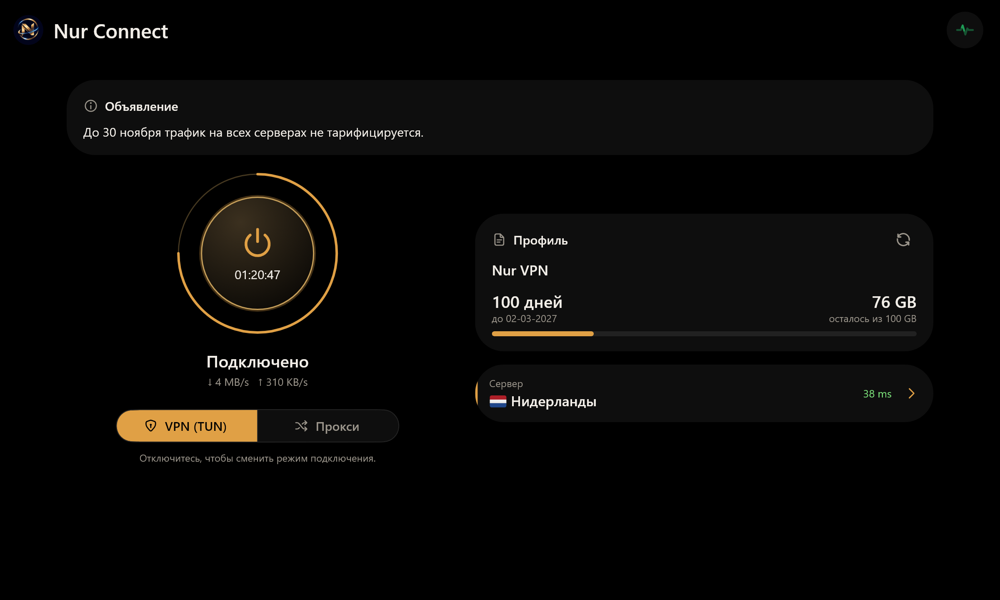
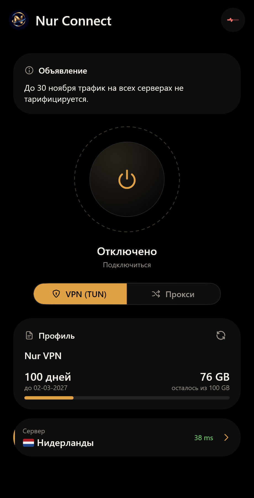
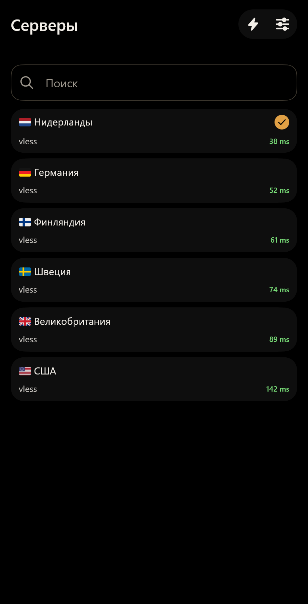

<p align="center"></p>

<p align="center">
  <a href="https://nurconnect.app">Сайт</a> ·
  <a href="https://github.com/Nurullaev/nur-connect-windows/releases">Выпуски</a> ·
  <a href="docs/windows/roadmap.md">План развития</a> ·
  <a href="README_EN.md">English</a> ·
  <a href="README_ZH.md">简体中文</a>
</p>

# Nur Connect для Windows

Подписка, выбор сервера и подключение одной кнопкой — в чёрно-золотом стиле Nur Connect.
Самостоятельный проект на базе [FlClashX](https://github.com/pluralplay/FlClashX),
[FlClash](https://github.com/chen08209/FlClash) и ядра [Mihomo](https://github.com/MetaCubeX/mihomo).

<p align="center">
  
</p>
<p align="center">
  
  &nbsp;
  
</p>

<sub>Скриншоты сделаны на демонстрационной подписке.</sub>

## Возможности

- **Одна кнопка.** Большая кнопка питания: пунктирное кольцо — отключено, бегущая
  золотая дуга — подключение, светящееся кольцо с таймером и скоростью — подключено.
- **VPN или прокси.** Переключатель VPN (TUN) / Прокси под кнопкой; по умолчанию VPN.
- **Подписка на виду.** Срок, остаток трафика, обновление и объявление провайдера сверху.
- **Серверы.** Флаги, задержка, поиск и сортировка; выбранный сервер отмечен золотом.
- **Импорт подписки** по ссылке с понятными ошибками и повтором без потери введённого.
- **Обновления.** Приложение само предлагает новую версию: «Обновить» или «Позже».
- **Отдельная установка.** Свои процессы, служба, каталоги данных и URI-схемы —
  ставится рядом с FlClashX и не мешает ему.
- Переведено на русский, английский, испанский, французский, японский, корейский и китайский.

Приложение для Windows развивается отдельно от одноимённых мобильных проектов.

## Текущий этап

Последняя предварительная версия — на странице
[выпусков](https://github.com/Nurullaev/nur-connect-windows/releases): установщик x64,
переносимый ZIP, исходники и контрольные суммы. Проверки и ограничения — в
[документе сборки](docs/windows/first-build.md). Установщик пока без цифровой подписи,
поэтому Windows может показать предупреждение SmartScreen.

Сайт: **[nurconnect.app](https://nurconnect.app)**.

## Сборка из исходников

Нужна Windows с Flutter/Dart, Go, Rust MSVC, Visual Studio Build Tools (Desktop
C++, CMake, Windows SDK и ATL), а для установщика — Inno Setup 6.
Закреплённая версия Rust для native API: `1.99.0`.

```powershell
git clone --recurse-submodules https://github.com/Nurullaev/nur-connect-windows.git
cd nur-connect-windows
flutter config --enable-windows-desktop
flutter pub get
flutter analyze
flutter test
dart setup.dart windows --env pre --arch amd64
```

Для одного переносимого архива добавьте `--targets zip`. Пакеты находятся в
`dist/`. Подробности среды и фактических проверок — в документе первой сборки.
Для собственных подписанных обновлений нужны свои ключи, которые нельзя хранить
в публичном репозитории.

## Документация

| Документ | Содержание |
| --- | --- |
| [План работ](docs/windows/roadmap.md) | Сделанное и следующие этапы |
| [Идентификаторы Windows](docs/windows/identity.md) | EXE, служба, AppData, схемы импорта и User-Agent |
| [Первая сборка](docs/windows/first-build.md) | Проверки, toolchain и ограничения |
| [Обновления](docs/windows/updates.md) | Автопроверка, каналы и выпуск новых версий |
| [NOTICE](NOTICE.md) | Происхождение и наши изменения |

Внутреннее имя Dart-пакета `fl_clash` и совместимые заголовки подписки
`flclashx-*` сохранены. Поддерживаемая платформа этого форка — Windows;
каталоги остальных платформ унаследованы из базы.

## Открытый код и авторы

Лицензия — [GNU GPL v3](LICENSE). Исходный код, сведения об авторах и лицензии
компонентов сохранены. Изменения Nur Connect начаты 20 ноября 2026 года.
При распространении изменённых сборок нужно предоставлять соответствующие
исходники и соблюдать условия лицензий.

База: FlClashX `0.5.8+2026111801`, коммит
`a9bbb66f6aec3e47359819c93976148a1d270e23`; Mihomo `v1.19.34`.
Nur Connect не является официальным выпуском FlClashX, FlClash или Mihomo.
