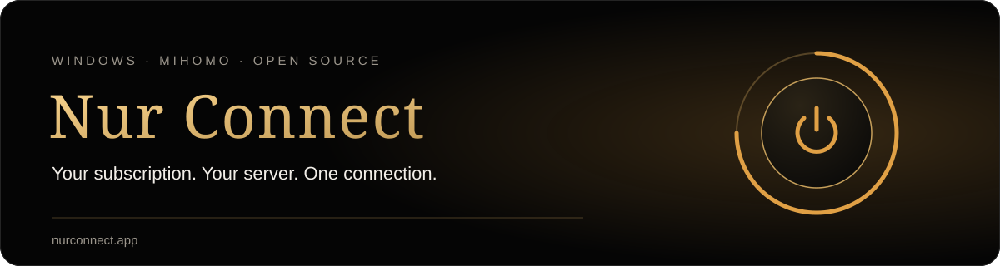
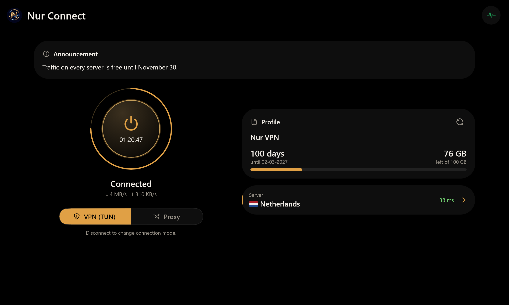
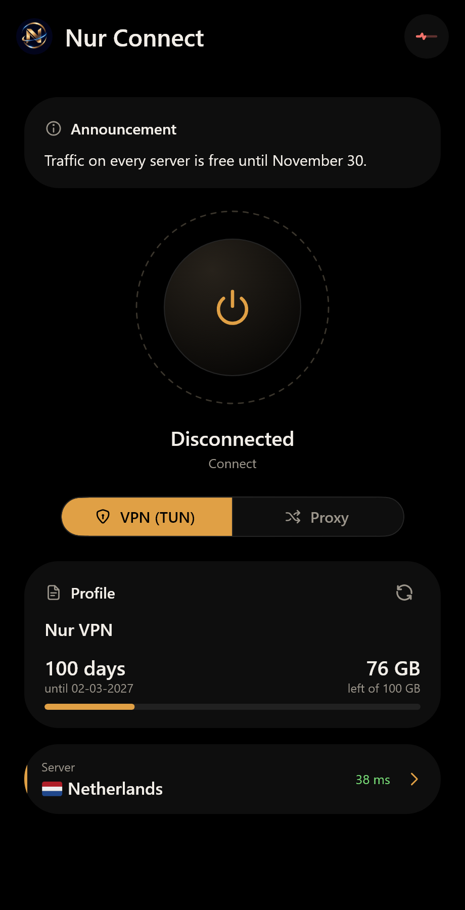
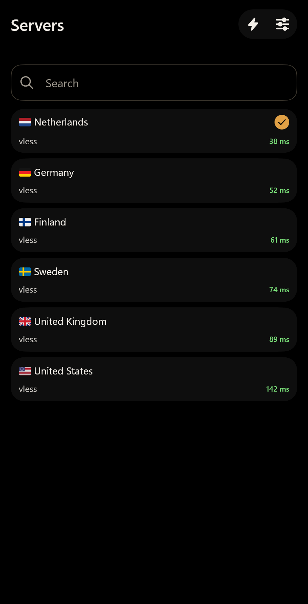

<p align="center"></p>

<p align="center"><a href="README.md">Русский</a> · <a href="README_ZH.md">简体中文</a> · <a href="https://nurconnect.app">Website</a> · <a href="https://github.com/Nurullaev/nur-connect-windows/releases">Releases</a></p>

# Nur Connect for Windows

Your subscription, your server and one button to connect, in Nur Connect's black and gold.
An independent Windows client built on [FlClashX](https://github.com/pluralplay/FlClashX), [FlClash](https://github.com/chen08209/FlClash) and [Mihomo](https://github.com/MetaCubeX/mihomo).

<p align="center">
  
</p>
<p align="center">
  
  &nbsp;
  
</p>

<sub>Screenshots use a demo subscription.</sub>

- **One button.** A dashed ring when idle, a running gold arc while connecting, and a lit ring with the time and speed once connected.
- **VPN or proxy.** A VPN (TUN) / Proxy switch under the button; VPN by default.
- **Your plan at a glance.** Days left, remaining traffic, refresh and the provider's announcement on top.
- **Servers.** Flags, latency, search and sorting; the chosen server is marked in gold.
- **Provider links.** Web page, account, bot and support straight from the subscription headers; Happ's keys for the brand name, promotion, renewal link and fallback domain work too.
- **Clear refusals.** "Subscription has ended" with Renew, and a device-limit dialog with the provider's words and support.
- **Subscription import** with clear errors and a retry that keeps what you typed.
- **Updates.** The app offers each new version with Update / Later; see [updates](docs/windows/updates.md).
- **Installs on its own.** Separate processes, helper service, data folders and URI schemes, so it sits beside FlClashX.
- Translated into Russian, English, Spanish, French, Japanese, Korean and Chinese.

The newest version is on the [latest release](https://github.com/Nurullaev/nur-connect-windows/releases/latest) with an x64 installer, portable ZIP, source archive and checksums. From then on the app updates itself with Update / Later. See the [roadmap](docs/windows/roadmap.md). The installer is not code-signed yet, so Windows may show a SmartScreen warning.

Installed a 0.1.0-pre preview? It is a separate app, "Nur Connect Pre", on its own update channel and will not move to 1.0.0 by itself. Install 1.0.0, add your subscription again and remove Nur Connect Pre in Settings → Apps.

Build on Windows with Flutter, Go, Rust MSVC (`1.99.0` for the native API), Visual Studio C++ tools/CMake/Windows SDK/ATL and Inno Setup 6:

```powershell
flutter pub get
flutter analyze
flutter test
dart setup.dart windows --env stable --arch amd64
```

`--env pre` builds the separate "Nur Connect Pre" preview copy.

Outputs go to `dist/`. Add `--targets zip` for a portable archive only. Provider-signed updates require our own signing keys; the upstream key is no longer trusted.

[GPL v3](LICENSE). Original author credits and third-party licenses are retained; see [NOTICE](NOTICE.md). Source base: FlClashX `a9bbb66f6aec3e47359819c93976148a1d270e23`, Mihomo `v1.19.34`. This is a separate project from the similarly named mobile apps and is not an official upstream release.
