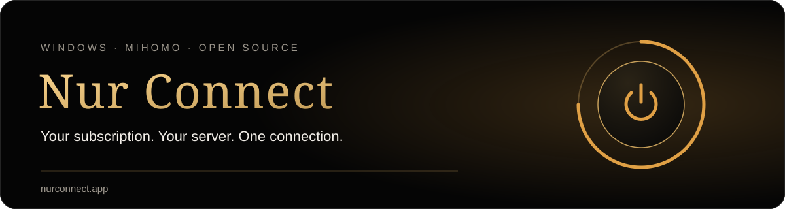
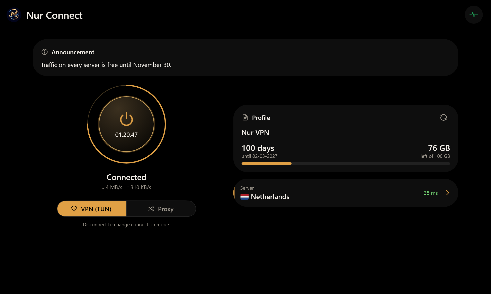
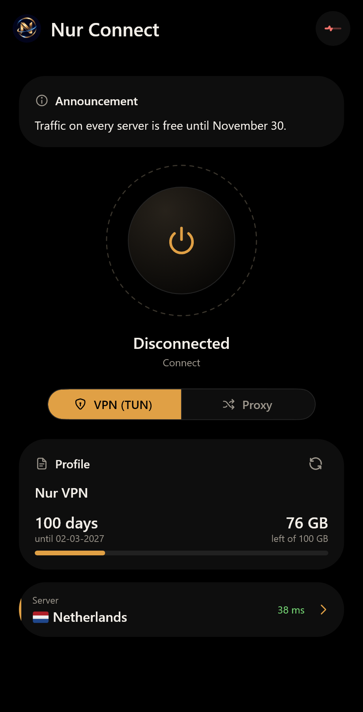
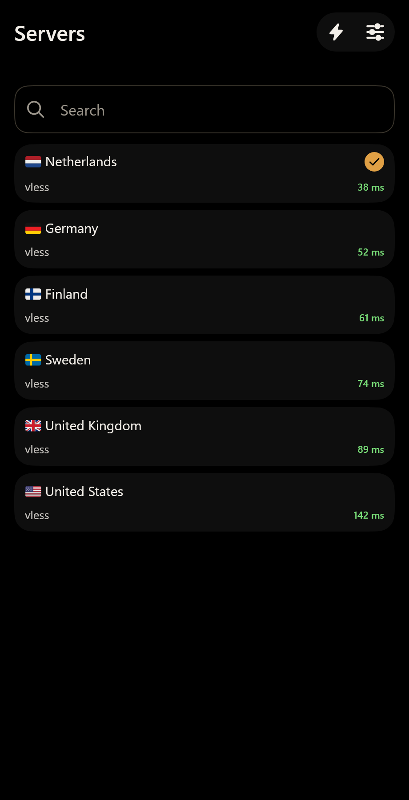

<p align="center"></p>

<p align="center"><a href="README.md">Русский</a> · <a href="README_EN.md">English</a> · <a href="https://nurconnect.app">官网</a></p>

# Nur Connect Windows 版

订阅、服务器和一键连接，采用 Nur Connect 的黑金风格。基于 [FlClashX](https://github.com/pluralplay/FlClashX)、[FlClash](https://github.com/chen08209/FlClash) 和 [Mihomo](https://github.com/MetaCubeX/mihomo) 的独立 Windows 客户端。

<p align="center">
  
</p>
<p align="center">
  
  &nbsp;
  
</p>

<sub>截图使用演示订阅。</sub>

- **一键连接**：未连接时为虚线圆环，连接中为流动的金色弧线，连接后圆环点亮并显示时长与速度。
- **VPN 或代理**：按钮下方可切换 VPN (TUN) / 代理，默认 VPN。
- **订阅一目了然**：剩余天数、剩余流量、刷新，以及置顶的服务商公告。
- **服务器**：国旗、延迟、搜索与排序，所选服务器以金色标记。
- **订阅导入**：清晰的错误提示，重试时保留已输入的链接。
- **更新**：有新版本时提示“更新 / 稍后”。
- **独立安装**：独立的进程、服务、数据目录和导入协议，可与 FlClashX 并存。
- 已翻译为俄语、英语、西班牙语、法语、日语、韩语和中文。

最新预览版见[发布页面](https://github.com/Nurullaev/nur-connect-windows/releases)，提供 x64 安装程序、便携 ZIP、源代码和校验文件。请参阅[构建状态及限制](docs/windows/first-build.md)和[路线图](docs/windows/roadmap.md)。安装程序暂未进行代码签名，Windows 可能显示 SmartScreen 提示。

在 Windows 上安装 Flutter、Go、Rust MSVC（本机 API 使用 `1.99.0`）、Visual Studio C++/CMake/Windows SDK/ATL 和 Inno Setup 6 后：

```powershell
flutter pub get
flutter analyze
flutter test
dart setup.dart windows --env pre --arch amd64
```

构建产物位于 `dist/`。仅生成便携压缩包可添加 `--targets zip`。

采用 [GNU GPL v3](LICENSE) 许可证，保留原作者及第三方许可信息，详情见 [NOTICE](NOTICE.md)。基础版本：FlClashX `a9bbb66f6aec3e47359819c93976148a1d270e23`、Mihomo `v1.19.34`。本项目与同名移动端项目分开开发，并非上游官方发行版。
